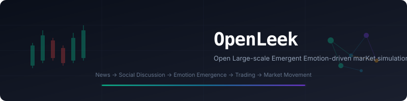
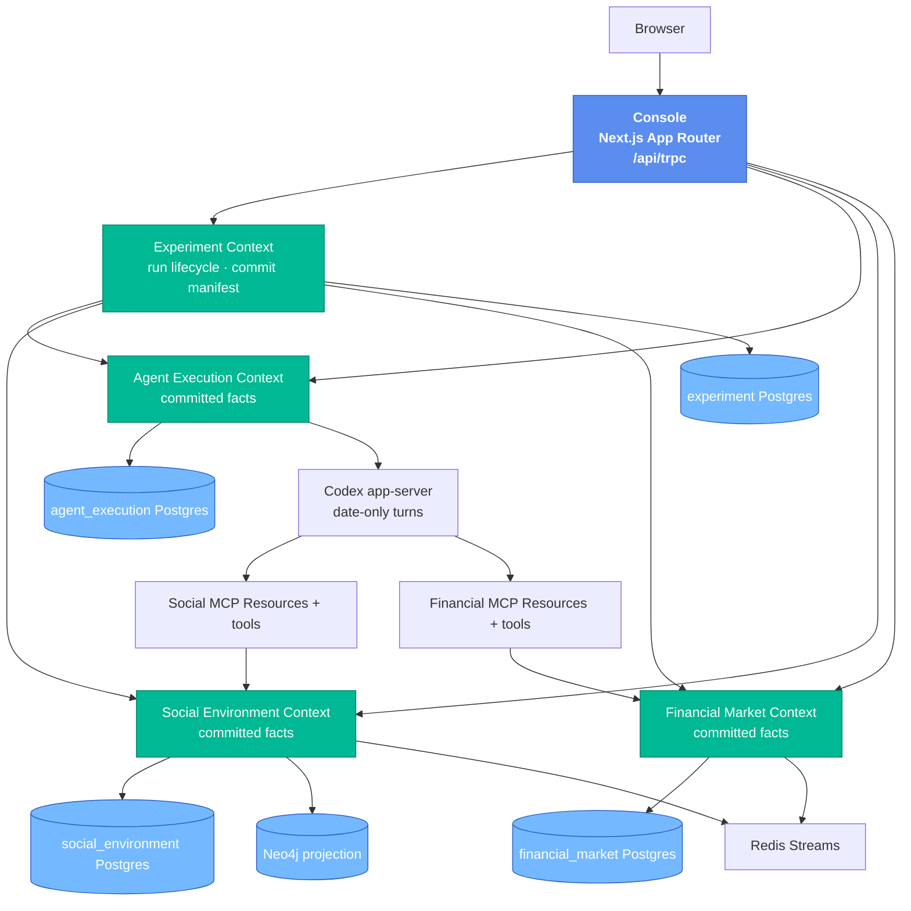

<div align="center">



# OpenLeek 🧅

**Open Large-scale Emergent Emotion-driven marKet simulation**

LLM Agent social market simulation — observe how narratives, social propagation, market-maker liquidity, and order books jointly shape prices

[](https://nodejs.org/)
[](LICENSE)
[](package.json)
[](CHANGELOG.md)
[](package.json)
[](apps/agent-execution/)
[](crates/matching-engine/)
[](docs/index.md)
[](https://github.com/Noesis-AI-Technologies/OpenLeek/stargazers)
[](https://github.com/Noesis-AI-Technologies/OpenLeek/commits/main)
[](https://github.com/Noesis-AI-Technologies/OpenLeek/pulls)

[Docs](docs/index.md) · [Quickstart](#-quickstart) · [Architecture](#-architecture) · [Changelog](CHANGELOG.md)

**[中文](README.md) | English**

</div>

---

## 💡 Core Idea

> **How can one piece of news trigger a market crash within 24 hours?**

```
Breaking News → Social Media Spread → KOL Interpretation → Collective Panic → Stampede Selling → Price Crash → Secondary Panic
```

OpenLeek aims to build an **auditable and replayable digital financial ecosystem**: LLM Agents do not only trade, they also have social identities. The current v2 runtime has four Bounded Contexts — Experiment, Agent Execution, Social Environment, and Financial Market. Console is the only browser control plane, while Experiment coordinates and commits cross-Context rounds.

## 🔥 Why OpenLeek?

Existing LLM Agent simulation platforms either **only do social** (OASIS, Generative Agents), **only do trading** (ABIDES, FinRL), or make it hard to place social behavior, trading, audit, and replay in one verifiable loop. OpenLeek v1 establishes that engineering boundary first:

| | OpenLeek | OASIS | ABIDES | FinRL |
|---|---|---|---|---|
| **Social + Trading Unified** | ✅ Four Contexts coordinate social and trading in one committed round | Social only | Trading only | Simplified |
| **Million-Scale Agents** | 🚧 roadmap | ~10K | ~1K | ~100 |
| **Real Matching Engine** | ✅ in-memory LOB + Rust N-API adapter | ❌ | ✅ | Simplified |
| **Sentiment Causal Inference** | 🚧 replayable committed artifacts and facts first | ❌ | ❌ | ❌ |
| **Stylized Facts Validation** | 🚧 research layer | ❌ | Partial | ❌ |
| **Information Asymmetry** | ✅ Context-owned observations and committed-fact boundary | ❌ | Partial | ❌ |
| **Network Topology Effects** | 🚧 Neo4j publish-only projection is wired | Fixed graph | ❌ | ❌ |
| **Explainable Emergence** | ✅ manifests, checkpoints, facts, and artifacts are traceable | Partial | ❌ | ❌ |
| **Agent Behavior Scheduling** | ✅ Codex app-server + restricted OpenLeek MCP | ❌ | Fixed rules | ❌ |

### Four Unique Capabilities

**1. Sentiment-Market Causal Loop** — Experiment seals every round into a manifest. Social Environment, Agent Execution, and Financial Market consume explicit checkpoints and committed facts, preserving traceable inputs for later causal analysis.

**2. Micro-Explainable Emergent Behavior** — PostgreSQL records runs, rounds, checkpoints, manifests, artifacts, and Context facts for each commit. Console reads committed results only.

**3. Clear Domain Boundaries** — Each Context owns its PostgreSQL database and owner role. Console has no database credential, and Social's Neo4j is a publish-only projection rebuilt from Postgres.

**4. Static/Dynamic Separation** — Static identity lives in each opaque `AGENTS.md`, while reusable workflows are materialized from published Skill versions under `.agents/skills`; Experiment owns Turn Prompt assets, Run selection, and frozen variables, while Agent Execution only consumes the frozen projection and renders each Codex turn. Each Agent Blueprint explicitly references an immutable MCP Policy and grants optional Context access. Skills may declare dependencies, but Contexts remain the authority and expose dynamic Resources and Tools only through the Run-frozen allow-list.

## ✨ Core Features

| | Feature | Description |
|---|---|---|
| 🧠 | **Agent Execution** | Each Agent uses a persistent Codex thread; static conditions come from its workspace, reads are pinned to a Context revision, and Context MCP accepts writes asynchronously |
| 🎯 | **Auditable initialization and commits** | Runs, mutation headers, checkpoints, and manifests have explicit references and idempotency boundaries |
| 📈 | **Matching baseline** | In-memory LOB supports limit orders and price-time priority; the Rust N-API binding runs inside Financial Market |
| 🌊 | **Recoverable runtime** | Each round pins two complete Context revisions; Context workers process intents asynchronously and Experiment advances only a composite manifest HEAD |
| 🗣️ | **Social Environment** | Owns social facts and committed-fact queries; Neo4j stores only a rebuildable publish projection |
| 🌐 | **Next.js/tRPC topology** | Five HTTP Context services, three workers, and Redis Streams delivery; Context PostgreSQL remains the fact owner |
| 🔬 | **Replay-first data** | Committed manifests, Context facts, and artifacts provide stable inputs for analysis and fork |
| 📊 | **Console control plane** | Browsers reach Console only; it never accesses a Context database and displays committed results only |
| 🔌 | **Runtime contract validation** | Zod contracts validate tRPC input; domain failures map to one actionable error shape |
| 🤖 | **Fixed research provider** | Public research runs use Codex only; test doubles are internal dependency injection only |
| 🧪 | **Recovery verification** | Unit, contract, Playwright, Compose-isolation, and real-provider two-round restart checks cover the recovery path |

## 🏗️ Architecture



See [Context boundaries](docs/architecture/CONTEXTS.md) and
[Five-service Next/tRPC runtime](docs/architecture/FOUR_CONTEXT_RUNTIME.md) for the complete boundary.

## 🚀 Quickstart

Node.js 22 or later is required. This repository uses a pnpm workspace. Enable Corepack before first use; it reads the pnpm version pinned in the root `package.json`. Start by creating a local Compose environment from the template:

```bash
cp .env.example .env
corepack enable
pnpm install --frozen-lockfile
pnpm run typecheck
pnpm test
pnpm run verify:architecture
pnpm run verify:compose
pnpm run compose:up
```

Set `DEEPSEEK_API_KEY`, an absolute Docker-writable
`OPENLEEK_SANDBOX_RUNS_HOST_PATH`, and a random
`OPENLEEK_SANDBOX_APP_SERVER_TOKEN`. Build an isolated immutable release with
`pnpm build:prebuilt`, then reconcile production with `pnpm compose:up`.
The main `openleek` project owns Infrastructure/Core, while
`openleek-financial`, `openleek-social`, and `openleek-news` are independently operable Context
projects. Production Next.js services run only their selected standalone artifacts.

Each Run receives its own Codex home with a fixed `deepseek-v4-flash`
Responses provider and model catalog. Dynamic sandboxes reach DeepSeek through
the dedicated egress network and a single Context Gateway network. The Gateway
enforces the Run/Agent bearer and MCP Policy; sandboxes never join Financial,
Social, or News internal networks. The DeepSeek key is injected only into app-server and excluded from the
Agent shell environment; shell snapshots and login shells are disabled so
neither disk snapshots nor profiles can reintroduce it. On Ubuntu hosts with the AppArmor unprivileged-userns
restriction, `pnpm compose:up` installs and loads
`infra/apparmor/openleek-codex-userns` through non-interactive sudo and refuses
to reconcile if the profile cannot be loaded. LLM Configuration remains
independent and configures Hindsight memory only.

Social and Financial each serve a Streamable HTTP MCP endpoint. Experiment registers a run-local principal for every agent when the run is created, then signs two audience-isolated Ed25519 bearer credentials. Each Context verifies with its public key and authorizes through its local actor/account binding, active turn scope, and the published MCP Policy's tool/resource allow-list. Agent Execution writes endpoint bindings and bearer headers to the static Codex workspace. Experiment owns no agent-facing MCP, frozen observation, or staged actions. Public specifications and Console expose no OpenAI backend selection or execution path.

Use `pnpm compose:financial:*`, `pnpm compose:social:*`, and `pnpm compose:news:*` for targeted up,
stop, ps, and logs operations. Full production releases still use
`pnpm compose:up`; the project split preserves the existing PostgreSQL, Redis,
and Neo4j volumes.

> **Upgrade notice:** the work-pool format is incompatible with the old synchronous two-phase rounds. Before upgrading a populated Compose deployment, stop the stack and clear the PostgreSQL, Neo4j, and Agent-run volumes, then let bootstrap create clean owner databases:
>
> ```bash
> docker compose --env-file .env -f infra/docker-compose.contexts.yml down --volumes
> pnpm run compose:up
> ```

<details>
<summary><b>⚙️ Key environment variables</b></summary>

```bash
# Console is the only host-published service
export OPENLEEK_CONSOLE_PORT=13000

# Console access gate; do not commit either deployment secret.
export OPENLEEK_CONSOLE_ACCESS_PASSWORD='choose-a-strong-password'
export OPENLEEK_CONSOLE_ACCESS_SESSION_SECRET='a-long-random-secret'

# Per-Run Codex app-server backend
export DEEPSEEK_API_KEY='deployment-deepseek-key'
export OPENLEEK_SANDBOX_APP_SERVER_TOKEN='deployment-capability-token'
export OPENLEEK_SANDBOX_RUNS_HOST_PATH=/absolute/path/for/codex-runs

# Context-owned Streamable HTTP MCP endpoints, bound to host loopback
export OPENLEEK_SOCIAL_MCP_PORT=3106
export OPENLEEK_FINANCIAL_MCP_PORT=3107

# Only Experiment receives the private key; Contexts receive the matching public key.
export OPENLEEK_EXPERIMENT_CREDENTIAL_KID=local-ed25519-v1
export OPENLEEK_EXPERIMENT_CREDENTIAL_PRIVATE_KEY="<PEM_PRIVATE_KEY>"
export OPENLEEK_EXPERIMENT_CREDENTIAL_PUBLIC_KEY='-----BEGIN PUBLIC KEY-----...'
```

See [`.env.example`](.env.example) for the full variable list and local defaults.

</details>

## 🛠️ Tech Stack

| Layer | Technology |
|---|---|
| **Frontend/control plane** | Next.js 15 App Router · React 19 · Console tRPC client |
| **State/communication** | tRPC procedures · HTTP/JSON batch transport · round manifests · restart/recovery protocol |
| **Backend** | TypeScript · Node.js ≥22 · Zod runtime contracts |
| **Matching** | In-memory LOB · Rust N-API matching adapter |
| **Social** | Context-owned PostgreSQL facts · Neo4j publish-only projection |
| **AI/inference** | Codex app-server · Context-owned HTTP MCP Resources · internal deterministic tests |
| **Service topology** | Five HTTP services: Console, Experiment, Agent Execution, Social Environment, and Financial Market, plus an independent `experiment-worker` |
| **Storage** | One PostgreSQL database/owner role per Context · committed manifests · artifacts |
| **Infrastructure** | Docker Compose · pnpm workspace · Playwright · Rust Cargo tests |

## 🎯 Research Scenarios

OpenLeek is particularly suited for the following research questions:

| Scenario | Experiment Design | Expected Observation |
|----------|-------------------|---------------------|
| **Panic Selling Contagion** | Inject major bearish news → observe panic spreading speed in social network and market reaction | KOL amplification effect in scale-free networks |
| **Information Asymmetry Pricing** | Some Agents receive information early → observe how informed traders affect price discovery | Insider information percolation speed and market efficiency |
| **Herding and Bubbles** | Continuously inject positive sentiment → observe tipping point from rational chasing to irrational bubble | Formation conditions of information cascades |
| **Market Maker Liquidity Crisis** | Under extreme volatility → observe market maker order withdrawal and liquidity depletion | Micro-mechanism of flash crashes |
| **Network Topology and Information Efficiency** | Compare three network structures → propagation differences of same news across topologies | Small-world vs. scale-free network market impact |
| **Conflicting News** | Inject bullish and bearish simultaneously → observe market pricing under contradictory information | Agent cognitive dissonance and market oscillation |

## 📋 Project Status

**v2.0.0** — Next.js/tRPC four-Context runtime

- ✅ **Five-service topology**: Console, Experiment, Agent Execution, Social Environment, and Financial Market are independent Next.js App Router services.
- ✅ **tRPC/HTTP business boundary**: Browsers reach Console only; Console and Experiment call Contexts through network tRPC. Plain HTTP remains only for `/health` and `/ready`.
- ✅ **Independent data ownership**: Every Context owns its PostgreSQL database/owner role. Social's Neo4j is rebuildable, and Console reads no database.
- ✅ **Recovery and fork**: Experiment commit manifests, mutation headers, and Context checkpoints support idempotent recovery, two-round restart, and committed-state fork.
- ✅ **Real Agent runtime validation**: Codex app-server uses date-only turns and Context-owned HTTP MCP; public research runs expose no second backend.
- ✅ **Current verification**: workspace typecheck/test/lint, architecture and Compose checks, five production builds, Playwright, and Rust matching-engine tests have passed.

<details>
<summary><b>v1.0.1</b> — v3 service boundary hardening (historical record)</summary>

**v1.0.1** — v3 service boundary hardening

- ✅ **v3 gRPC business plane**: Exchange, Broker, Market Maker, Social Platform, and related business calls now converge on strongly typed protobuf/gRPC contracts; HTTP remains the control plane.
- ✅ **Runtime-authoritative resume/fork**: Runtime owns the committed round, snapshot timeline, resume point, and fork lineage; domain hydrate follows the Runtime commit cursor.
- ✅ **External service mode hardening**: Docker compose wiring, service environment variables, `runs/` debug output, Agent SDK sessions, and OTEL trace paths are explicitly configured.
- ✅ **Default Sandbox path**: Sandbox Agent reaches the provider directly through Codex and emits staged intents through scoped MCP.
- ✅ **Market behavior fixes**: Market Maker, Broker/Exchange adapters, Social Platform hydrate, Runtime rollback/recovery, and other v3 boundaries have expanded regression coverage.
- ✅ **Pressure-test boundary closure**: repo-local LLM pressure-test harness artifacts and the old `ReplayAgentBrain` production pressure-test path were removed; research runs no longer accept prompts or backend selection.

</details>

<details>
<summary><b>v1.0.0</b> — v3 independent service boundary</summary>

- ✅ **v3 service graph**: Runtime, Orchestrator, Agent, Broker, Market Maker, Exchange, Social Client, and Social Platform can each start as an independent HTTP service.
- ✅ **Controlled call boundary**: Agent connects only to Orchestrator; Orchestrator mediates Agent I/O; Broker connects to Exchange and Market Maker; Social Client connects to Social Platform.
- ✅ **Recovery/rebuild boundary**: Runtime owns run state, snapshot timeline, round commit boundary, and resume point; Redis is live/projection/cache only.
- ✅ **Verifiable container entrypoint**: full local v3 compose and external-dependency endpoint compose are available; each service has its own Dockerfile and shares the same base image.

</details>

<details>
<summary><b>v0.27.4</b> — Canonical social archive + Live history hydration</summary>

- ✅ **Canonical social archive**: added the `social_posts` archive table to sync OASIS runtime posts into OpenLeek persistence
- ✅ **All-round Social Feed query**: `round_num=0` returns posts from all rounds; positive round numbers still filter a single round
- ✅ **Live page history hydration**: simulation pages load `/rounds` history first, then merge WebSocket deltas

</details>

<details>
<summary><b>v0.27.3</b> — OASIS runtime alignment</summary>

- ✅ **Python 3.11 runtime**: OASIS/CAMEL currently supports Python `<3.12`, so Docker/CI/API installs are aligned on Python 3.11
- ✅ **Default images include OASIS**: API/dev Docker installs include the `social` extra, preventing `SOCIAL_ENGINE_UNAVAILABLE` caused by missing backend dependencies

</details>

<details>
<summary><b>v0.27.2</b> — OASIS social integration docs and runtime status semantics</summary>

- ✅ **Local/API simulations connect directly to OASIS by default**: `social.enabled: true` creates an OASIS social platform; `social.enabled: false` is reserved for no-social ablation
- ✅ **No fallback sentiment**: when social is disabled, OpenLeek does not synthesize sentiment from scheduled news; sentiment must come from OASIS posts/comments
- ✅ **Visible social status in the UI**: experiment pages expose social config, and live simulation shows OASIS pending/initializing/running/unavailable/disabled states

</details>

<details>
<summary><b>v0.27.1</b> — Simulation error handling pipeline</summary>

- ✅ LLM credential pre-validation + early termination when all agents fail repeatedly
- ✅ WebSocket initial state push for late clients
- ✅ Frontend simulation failed/completed banners + Settings LLM batch validation

</details>

<details>
<summary><b>v0.27.0</b> — Optional User Management System (Email Auth + Invite-Only + Data Isolation)</summary>

- ✅ **Feature Flag Authentication**: Enable with `OPENLEEK_USER_AUTH=true` at deploy time, zero behavior change when disabled
- ✅ **Email + Password Auth**: bcrypt hashing + JWT HS256 tokens + auto token refresh
- ✅ **Invite-Only Registration**: Admin creates invitation codes to control sign-up access
- ✅ **Complete Data Isolation**: Per-user simulations + experiments, system templates visible to all
- ✅ **Frontend Login/Register**: AuthGuard route protection + sidebar user info + i18n bilingual
- ✅ **Admin API**: User management + invitation code management + role control

</details>

<details>
<summary><b>v0.26.0</b> — K-Line Chart + Caddy Reverse Proxy + CI/CD Auto Deploy</summary>

- ✅ **K-Line Chart Page** (`/market`): ECharts candlestick + volume dual-axis chart, WebSocket real-time updates, up/down color mode toggle (CN red-up / Intl green-up), DataZoom
- ✅ **Caddy Reverse Proxy** (`--profile proxy`): Auto HTTPS (Let's Encrypt), dev/prod dual Caddyfile, SPA fallback
- ✅ **CI/CD Auto Deploy**: GitHub Actions SSH deploy job → GHCR image pull → frontend extraction → service restart
- ✅ **`docker-compose.prod.yml`** production override: GHCR image instead of local build, frontend static serving

</details>

<details>
<summary><b>v0.25.0</b> — Agent Types Management + Settings Tooltips + Experiment Bilingual Descriptions</summary>

- ✅ **Agent Types CRUD API + Frontend Page**: 10 built-in agent types + custom type persistence
- ✅ **Settings Tooltip System**: `@floating-ui/react` powered, bubble explanations for all strategy/social engine parameters
- ✅ **Experiment Bilingual Descriptions**: YAML `description_zh` + frontend auto language switching
- ✅ **"Agents" page renamed to "Behavior Replay"**: Clear separation of pre-run type definitions vs post-run data replay
- ✅ 561 tests all passing, TypeScript zero errors

- ✅ **DryRunChatModel**: Run complete simulation pipeline without real API calls, generates deterministic tool-call responses
- ✅ **`create_chat_model()` Factory**: the old runtime supported switching with `OPENLEEK_DRY_RUN=1` or `llm.dry_run: true`; current config uses `llm.backend: dry_run`
- ✅ **Frontend Visual Redesign**: Migrated from dark sci-fi to modern minimal light theme (violet brand + Framer Motion animations)
- ✅ **Playwright E2E Tests**: 11 frontend E2E tests (Dashboard + Experiments + Simulation)
- ✅ **Deterministic Support**: Pass seed parameter for reproducible test results

</details>

<details>
<summary><b>v0.23.2</b> — CI/CD + OpenTelemetry + Schema Normalization</summary>

- ✅ **CI/CD Enhancement**: Rust clippy/audit, Frontend typecheck/lint/build, Security audit, pre-commit hooks
- ✅ **OpenTelemetry Distributed Tracing**: Grafana Tempo integration
- ✅ **Database Schema Normalization**: trades/portfolios/agents 3 tables + indexes
- ✅ **Rust Engine**: `clear_trades()` + `trades_len()` memory leak fix
- ✅ **API Rate Limiting**: Token bucket per IP

</details>

<details>
<summary><b>v0.23.1</b> — Multi-Model Native Protocol + Frontend Multi-Model Config UI</summary>

- ✅ **Model Router**: Replaces direct OpenAI SDK usage, all providers use a configurable model adapter boundary
- ✅ **Per-Agent Model Routing**: Retail uses Qwen, institutions use Claude, with model selection handled by the ChatModel factory
- ✅ **Per-Model Relay**: Each model has independent `api_base`, adapts to various network environments
- ✅ **Frontend Multi-Model UI**: Settings dynamic model list editor (alias + provider/model + relay URL)

</details>

<details>
<summary><b>v0.23.0</b> — Social Engine 5 Optimizations + Frontend Social Visualization</summary>

- ✅ **Barrier Pub/Sub**: Event-driven round synchronization (latency 25ms → <1ms), compatible with poll fallback
- ✅ **Streaming RPC**: gRPC streaming interfaces (GenerateFeedsStream / ExecuteActionsStream / EvolveGraph)
- ✅ **Redis Cluster**: Cluster mode + read/write separation + Timeline sharding, horizontal scaling for social state
- ✅ **Feed Push Mode**: KOL fan-out optimization + inbox push + causal isolation
- ✅ **Graph Evolution**: Dynamic graph evolution engine (Triadic Closure / Weak Tie Decay / Viral Boost)
- ✅ **Frontend Pages**: SocialFeed (post timeline) + NetworkGraph (force-directed graph + event stream)

</details>

<details>
<summary><b>v0.22.0</b> — Rust Matching Engine Exclusive + Cargo Workspace Refactor</summary>

- ✅ Removed Python MatchingEngine fallback, Rust is the sole backend
- ✅ Cargo Workspace 3 crates: engine / engine-py / exchange-service
- ✅ Rust gRPC Exchange Service (tonic): 4 RPCs

</details>

<details>
<summary><b>v0.21.0</b> — Dual Attention Gate + Behavior Modifier Pluggable Strategy Framework</summary>

- ✅ **Attention Gate**: 4 strategies controlling Agent social/trade activation per round
  - `always_active` (default) / `threshold` / `event_driven` / `adaptive`
- ✅ **Behavior Modifier**: 4 prompt suffix injecting trading style
  - `neutral` (default) / `momentum` / `contrarian` / `adaptive`
- ✅ **Three-Mode Consistent Integration**: local + cluster (Ray Shard) + distributed (gRPC Worker) behavior fully consistent
- ✅ **Zero LLM Overhead**: Gate is pure rule computation, no performance bottleneck at million-scale
- ✅ **Research Safe**: hold/lurk explicitly records reason, Granger causality tests have no gaps
- ✅ **Frontend Strategy Tab**: Settings page adds Strategies config + dedicated parameter sliders
- ✅ **Ablation Experiments**: `ablation_attention_gate.yaml` control configuration
- ✅ **Stylized Facts Validation**: Auto-validates 6 Cont (2001) financial market empirical laws (fat tails / volatility clustering / no autocorrelation / volume-price correlation / non-normality / leverage effect)
- ✅ 484 tests all passing

</details>

<details>
<summary><b>v0.20.0</b> — Distributed Social Engine + Three-Mode Architecture + Frontend Modernization</summary>

- ✅ **Distributed Social Simulation**: Redis-backed PostStore + GraphStore + FeedGenerator
- ✅ **Independent Social LLM Step**: Each Agent makes independent social decision per round (OASIS behavior fidelity)
- ✅ **Three-Mode Architecture**: local (OASIS+SQLite) → cluster (Ray+Redis) → distributed (gRPC)
- ✅ **gRPC Services**: SocialService (50052) + ExchangeService (50051) + protobuf definitions
- ✅ **Distributed Worker**: Independent process managing Agents, Redis pub/sub round coordination
- ✅ **SocialActor** (Ray): Social state management + graph seeding + feed generation + sentiment aggregation
- ✅ **Social Prompt Replication**: OASIS Twitter/Reddit templates + JSON output parsing
- ✅ **Information Asymmetry**: info-tier filtering (expert/private view / social power users / retail dynamic)
- ✅ **Network Topology**: Barabási–Albert scale-free / Erdős–Rényi random / Watts–Strogatz small-world
- ✅ **Orchestration Integration**: Social phase fully integrated into `_run_round()` (batch + streaming)
- ✅ **Frontend Modernization**: Cluster monitor page + Checkpoint management + Settings 6-tab full expansion + distributed launch params + version alignment
- ✅ 440 tests all passing
</details>

<details>
<summary><b>Earlier Versions (v0.1 ~ v0.19)</b></summary>

Full history available in [Changelog](CHANGELOG.md)

</details>

See [Changelog](CHANGELOG.md) | [Issues](https://github.com/Noesis-AI-Technologies/OpenLeek/issues)

## 🙏 Acknowledgments

### Open Source

- [OASIS](https://github.com/camel-ai/oasis) — Large-scale social media simulation framework
- [MiroFish](https://github.com/666ghj/MiroFish) — Collective intelligence prediction engine
- [YuLan-OneSim](https://github.com/RUC-GSAI/YuLan-OneSim) — LLM-driven social science simulation platform
- [ABIDES](https://github.com/jpmorganchase/abides-jpmc-public) — Agent-Based financial market simulator

## 📈 Star History

<div align="center">

[](https://star-history.com/#Noesis-AI-Technologies/OpenLeek&Date)

</div>

## 📄 License

This project is open-sourced under the [GNU Affero General Public License v3.0 (AGPL-3.0)](LICENSE).

**This means:**
- ✅ Personal learning, academic research, non-commercial use — completely free
- ✅ Modifications and distributions must maintain the same license and remain open source
- ✅ Providing services over a network (SaaS) also requires open-sourcing modifications

> Sub-component `openleek-matching-engine` uses the MIT license and can be used independently.
