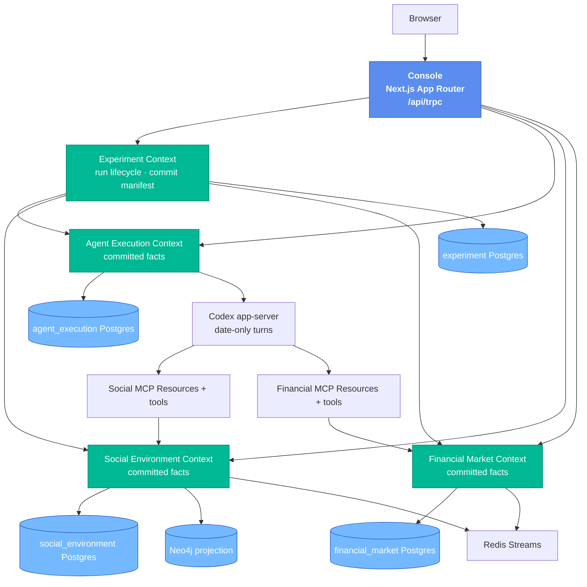

<div align="center">


# OpenLeek 🧅

**Open Large-scale Emergent Emotion-driven marKet simulation**

LLM Agent 社会化金融市场仿真平台 — 观察叙事、社交传播、做市流动性和订单簿如何共同塑造价格

[](https://nodejs.org/)
[](LICENSE)
[](package.json)
[](CHANGELOG.md)
[](package.json)
[](apps/agent-execution/)
[](crates/matching-engine/)
[](docs/index.md)
[](https://github.com/Noesis-AI-Technologies/OpenLeek/stargazers)
[](https://github.com/Noesis-AI-Technologies/OpenLeek/commits/main)
[](https://github.com/Noesis-AI-Technologies/OpenLeek/pulls)

[文档](docs/index.md) · [快速开始](#-快速开始) · [架构](#-架构) · [Changelog](CHANGELOG.md)

**中文 | [English](README-ENG.md)**

</div>

---

## 💡 核心理念

> **一条新闻，如何在 24 小时内引发一场市场崩盘？**

```
突发新闻 → 社交平台传播 → KOL 解读 → 群体恐慌涌现 → 踩踏式抛售 → 价格暴跌 → 二次恐慌
```

OpenLeek 的目标是构建一个**可审计、可回放的数字金融生态系统**：LLM Agent 不仅能交易，也拥有独立的社交身份。当前 v2 以 Experiment、Agent Execution、Social Environment 与 Financial Market 四个 Bounded Context 运行；Console 是唯一浏览器控制面，Experiment 负责跨 Context 的轮次协调与提交。

## 🔥 为什么选择 OpenLeek？

现有的 LLM Agent 模拟平台要么**只做社交**（OASIS、Generative Agents），要么**只做交易**（ABIDES、FinRL），要么**很难把社交、交易、审计和回放放进同一条可验证链路**。OpenLeek v1 先把这个闭环的工程边界搭起来：

| | OpenLeek | OASIS | ABIDES | FinRL |
|---|---|---|---|---|
| **社交 + 交易统一** | ✅ 四 Context 在同一 committed round 内协调社交与交易 | 仅社交 | 仅交易 | 简化 |
| **百万级 Agent** | 🚧 roadmap | ~10K | ~1K | ~100 |
| **真实撮合引擎** | ✅ in-memory LOB + Rust N-API adapter | ❌ | ✅ | 简化 |
| **情绪因果推断** | 🚧 先记录可回放的 committed artifacts 与 facts | ❌ | ❌ | ❌ |
| **Stylized Facts 验证** | 🚧 research layer | ❌ | 部分 | ❌ |
| **信息不对称** | ✅ Context-owned observation 与 committed fact 边界 | ❌ | 部分 | ❌ |
| **网络拓扑效应** | 🚧 Neo4j publish-only projection 已接入 | 固定图 | ❌ | ❌ |
| **可解释涌现** | ✅ manifest、checkpoint、facts 与 artifacts 可追溯 | 部分 | ❌ | ❌ |
| **Agent 行为调度** | ✅ Codex app-server + 受限 OpenLeek MCP | ❌ | 固定规则 | ❌ |

### 四大独特能力

**1. 情绪-市场因果闭环** — 每轮由 Experiment 固化 manifest；Social Environment、Agent Execution 与 Financial Market 只消费明确的 checkpoint 和 committed facts，为后续因果分析保留可追溯输入。

**2. 微观可解释的涌现行为** — PostgreSQL 中的 run、round、checkpoint、manifest、artifact 与 Context facts 记录每次提交；Console 只读取已提交的结果。

**3. 清晰的 domain 边界** — 四个 Context 各自拥有 PostgreSQL database 与 owner role。Console 不持有数据库凭据；Social 的 Neo4j 仅是从 Postgres 重建的 publish-only projection。

**4. 条件与动态状态隔离** — Agent 的静态人格写入 opaque 工作区的 `AGENTS.md`，可复用工作流以已发布 Skill 版本物化到 `.agents/skills`；Experiment 拥有轮次提示词资产、版本选择与 Run 冻结变量，Agent Execution 只消费冻结投影并为 Codex 渲染每轮文本。智能体蓝图显式引用不可变 MCP Policy 并授予可选 Context 访问，Skill 只能声明依赖，Context 仍依据 Run 冻结的 allow-list 暴露并授权动态 Resources 与 Tools。

## ✨ 核心特性

| | 特性 | 说明 |
|---|---|---|
| 🧠 | **Agent Execution** | 每个 Agent 使用持久 Codex thread；静态条件来自工作区，读取固定在 Context revision，动作由 Context MCP 异步接收 |
| 🎯 | **可审计初始化与提交** | Run、mutation header、checkpoint 与 manifest 都带有明确引用和幂等边界 |
| 📈 | **订单簿撮合基线** | in-memory LOB 实现限价单与价格时间优先；Rust N-API binding 在 Financial Market 服务内运行 |
| 🌊 | **可恢复运行过程** | 每轮 pin 两个完整 Context revision；独立 Context worker 异步处理 intent，Experiment 只推进组合 manifest HEAD |
| 🗣️ | **Social Environment** | 管理社交事实与 committed facts；Neo4j 只保存可从 Postgres 重建的 publish projection |
| 🌐 | **Next.js/tRPC 服务拓扑** | 五个 HTTP Context 服务、三个 worker 与 Redis Streams 投递；事实仍由 Context PostgreSQL 持有 |
| 🔬 | **回放优先的数据结构** | committed manifests、Context facts 与 artifacts 为分析和 fork 提供稳定输入 |
| 📊 | **Console 控制面** | 浏览器只访问 Console；Console 不直连任何 Context 数据库，且只展示已提交结果 |
| 🔌 | **运行时合约校验** | Zod contracts 校验 tRPC 输入；领域错误映射为统一的可处理错误数据 |
| 🤖 | **固定研究 Provider** | 公开研究运行固定为 Codex；测试可经内部依赖注入使用替身，绝不提供公开 OpenAI 入口 |
| 🧪 | **恢复行为验证** | 单元、合同、Playwright、Compose 隔离与真实 provider 两轮重启恢复共同覆盖 |

## 🏗️ 架构



详细边界见 [Context boundaries](docs/architecture/CONTEXTS.md) 与
[Five-service Next/tRPC runtime](docs/architecture/FOUR_CONTEXT_RUNTIME.md)。

## 🚀 快速开始

Node.js 版本要求为 22 或更高；本仓库使用 pnpm workspace。首次在本机使用前启用 Corepack；它会读取根 `package.json` 中固定的 pnpm 版本。先从环境模板创建本地 Compose 配置：

```bash
cp .env.example .env
corepack enable
pnpm install --frozen-lockfile
pnpm run typecheck
pnpm test
pnpm run verify:architecture
pnpm run verify:compose
pnpm run compose:up
```

启动前还需在 `.env` 中设置 Docker 可写的绝对 host 目录
`OPENLEEK_SANDBOX_RUNS_HOST_PATH`、随机的 `OPENLEEK_SANDBOX_APP_SERVER_TOKEN`
以及 `DEEPSEEK_API_KEY`。Hindsight 的独立 memory LLM 由
`OPENAI_BASE_URL`、`OPENAI_API_KEY` 和 `OPENLEEK_LLM_ROUTER_DEFAULT_MODEL`
在 LLM Configuration 首次启动时初始化。
目录须由部署者预先创建。启动后访问 `http://localhost:3000`。

生产发布先运行 `pnpm build:prebuilt`，从隔离副本构建并原子选择完整 standalone release；
`pnpm compose:up` 是唯一的完整生产 reconciliation 入口：主 `openleek` project 持有
Infrastructure/Core，`openleek-financial`、`openleek-social` 与 `openleek-news` 是可独立运维的 Context
project。入口按依赖顺序加载四组定义及各自的 prebuilt 覆盖，缺少完整 release 时拒绝启动。生产服务不运行 Fast Refresh、watcher 或 checkout 中的
`.next` 输出。

每个 Experiment 会创建一个共享的 Docker Codex Sandbox；它只加入该 Run 获准使用的
统一 `openleek-sandbox-context-gateway` 网络，并通过独立的 `openleek-run-egress` 直连 DeepSeek Responses API。Context Gateway 按 Run/Agent bearer 与 MCP Policy 路由获准的命名空间能力，Sandbox 不加入 Financial、Social 或 News 的内部网络。没有全局 app-server、宿主机 MCP loopback
端口或宿主机 `CODEX_HOME` 挂载。Sandbox 使用 `workspace-write`，完成或取消后会立即删除
容器和该 run 的 workspace/CODEX_HOME。每轮资源读取 pin 到完整 Context revision；
`experiment-worker` 与两个 Context worker 通过 Redis Streams 协调异步 intent 和完成事件。
Agent Execution 固定使用 `deepseek-v4-flash`，并为每个 Run 生成 `codex-home/config.toml`
与 `codex-home/models.json`。`DEEPSEEK_API_KEY` 只注入 app-server 进程并由 Codex shell
environment policy 排除，同时禁用 shell snapshot 与 login shell，避免磁盘快照或 profile
重新引入密钥。Ubuntu 启用
AppArmor unprivileged-userns 限制时，`pnpm compose:up` 会以非交互 sudo 安装并加载仓库内的
`infra/apparmor/openleek-codex-userns`，供 Codex 的 bubblewrap 内层 sandbox 使用；无法加载时
生产 reconciliation 会拒绝继续。LLM Configuration 仅为 Hindsight memory 提供独立配置。

Social 与 Financial 分别提供 Streamable HTTP MCP 端点。Experiment 会在创建 run 时为每个 agent 注册仅属于该 run 的 principal，并以 Ed25519 签发两个 audience 隔离的 bearer credential；Context 仅使用公钥验签，再以本地 actor/account binding、活跃 turn scope 和已发布 MCP Policy 的 tool/resource allow-list 授权。Agent Execution 只把端点和 bearer header 写入静态 Codex 工作区。Experiment 不拥有 agent-facing MCP、冻结观察或动作暂存。公开规格和 Console 不提供 OpenAI backend 的创建、选择或运行入口。

Financial、Social 与 News 可分别通过 `pnpm compose:financial:*`、`pnpm compose:social:*` 和 `pnpm compose:news:*`
执行 up、stop、ps、logs；完整发布仍必须使用 `pnpm compose:up`。拆 project 不迁移或删除
PostgreSQL、Redis、Neo4j 数据卷。

<details>
<summary><b>⚙️ 关键环境变量</b></summary>

```bash
# Console 是唯一发布到宿主机的服务
export OPENLEEK_CONSOLE_PORT=13000

# Console 登录门禁（密码和随机 session secret 均不提交到仓库）
export OPENLEEK_CONSOLE_ACCESS_PASSWORD='choose-a-strong-password'
export OPENLEEK_CONSOLE_ACCESS_SESSION_SECRET='a-long-random-secret'

# Per-Experiment Codex Sandbox and native DeepSeek provider.
export DEEPSEEK_API_KEY='deployment-deepseek-key'
export OPENLEEK_SANDBOX_RUNS_HOST_PATH=/absolute/path/for/openleek-sandbox-runs
export OPENLEEK_SANDBOX_APP_SERVER_TOKEN='deployment-capability-token'

# Hindsight memory bootstrap (independent from Agent inference).
export OPENAI_BASE_URL=https://api.openai.com/v1
export OPENAI_API_KEY='deployment-memory-key'
export OPENLEEK_LLM_ROUTER_DEFAULT_MODEL='memory-model'

# Experiment 私钥只配置给 Experiment；两个 Context 只配置匹配的公钥
export OPENLEEK_EXPERIMENT_CREDENTIAL_KID=local-ed25519-v1
export OPENLEEK_EXPERIMENT_CREDENTIAL_PRIVATE_KEY="<PEM_PRIVATE_KEY>"
export OPENLEEK_EXPERIMENT_CREDENTIAL_PUBLIC_KEY='-----BEGIN PUBLIC KEY-----...'
```

完整变量清单及本地默认值见 [`.env.example`](.env.example)。

</details>

真实 provider 的 E2E 是显式执行的：配置 `DEEPSEEK_API_KEY` 后运行
`OPENLEEK_RUN_SANDBOX_E2E=1 pnpm run test:e2e:real`。它要求真实 DeepSeek Responses provider，
在第一轮后重启该 Experiment 的 Sandbox，并验证第二轮的线程连续性、Context MCP 资源/动作、
Redis worker 和 Console committed/audit 视图；缺少 provider 配置时会失败，不会回退到 fixture。

Agent Execution 通过内部 Docker socket proxy 管理 Sandbox。该 proxy 仍允许创建/删除容器；
这是为了满足每 Experiment 动态 Sandbox 的已接受高权限边界，必须仅保留在内部网络并限制
Agent Execution 的部署权限。

## 🛠️ 技术栈

| 层 | 技术 |
|---|---|
| **前端/控制面** | Next.js 15 App Router · React 19 · Console tRPC client |
| **状态/通信** | tRPC procedure · HTTP/JSON batch transport · round manifest · restart/recovery protocol |
| **后端** | TypeScript · Node.js ≥22 · Zod runtime contracts |
| **撮合** | In-memory LOB · Rust N-API matching adapter |
| **社交** | Context-owned PostgreSQL facts · Neo4j publish-only projection |
| **AI/推理** | Codex app-server · Context-owned HTTP MCP Resources · internal deterministic tests |
| **服务拓扑** | Console、Experiment、Agent Execution、Social Environment、Financial Market 五个 HTTP 服务，加独立 `experiment-worker` |
| **存储** | 每个 Context 独立 PostgreSQL database/owner role · committed manifests · artifacts |
| **基础设施** | Docker Compose · pnpm workspace · Playwright · Rust Cargo tests |

## 🎯 研究场景

OpenLeek 特别适合以下研究问题：

| 场景 | 实验设计 | 预期观察 |
|------|----------|----------|
| **恐慌性抛售传导** | 注入重大利空 → 观察恐慌在社交网络中的扩散速度与市场反应 | 无标度网络中 KOL 的放大效应 |
| **信息不对称定价** | 部分 Agent 提前获得信息 → 观察知情交易者如何影响价格发现 | 内幕信息的渗透速度与市场效率 |
| **羊群效应与泡沫** | 持续注入正面情绪 → 观察从理性追涨到非理性泡沫的临界点 | 信息瀑布的形成条件 |
| **做市商流动性危机** | 极端波动下 → 观察做市商撤单行为与流动性枯竭 | 闪崩的微观机制 |
| **网络拓扑与信息效率** | 对比三种网络结构 → 同一新闻在不同拓扑中的传播差异 | 小世界网络 vs 无标度网络的市场影响 |
| **消息面对冲** | 同时注入利好利空 → 观察市场在矛盾信息下的定价过程 | Agent 认知失调与市场振荡 |

## 📋 项目状态

**v2.0.0** — Next.js/tRPC 四 Context 运行时

- ✅ **五服务拓扑**：Console、Experiment、Agent Execution、Social Environment 与 Financial Market 均为独立 Next.js App Router 服务。
- ✅ **tRPC/HTTP 业务边界**：浏览器只访问 Console；Console 与 Experiment 通过网络 tRPC 调用各 Context。普通 HTTP 只保留 `/health` 与 `/ready`。
- ✅ **独立数据所有权**：每个 Context 拥有独立 PostgreSQL database/owner role；Social 的 Neo4j 是可重建 projection；Console 不读取数据库。
- ✅ **恢复与 fork**：Experiment 的 commit manifest、mutation header 与 Context checkpoint 支持幂等恢复、两轮重启与 committed-state fork。
- ✅ **真实 Agent runtime 验证**：Codex app-server 通过 date-only turn 与 Context-owned HTTP MCP 运行；公开研究路径不提供第二个 backend。
- ✅ **当前验证**：workspace typecheck/test/lint、架构与 Compose 校验、五个生产构建、Playwright 和 Rust matching-engine tests 已通过。

<details>
<summary><b>v1.0.1</b> — v3 service boundary hardening（历史记录）</summary>

**v1.0.1** — v3 service boundary hardening

- ✅ **v3 gRPC business plane**：Exchange、Broker、Market Maker、Social Platform 等业务调用收敛到强类型 protobuf/gRPC contract；HTTP 保留为控制面。
- ✅ **Runtime-authoritative resume/fork**：Runtime 拥有 committed round、snapshot timeline、resume point 与 fork lineage；domain hydrate 以 Runtime commit cursor 为准。
- ✅ **外部服务模式加固**：Docker compose、服务环境变量、`runs/` debug output、Agent SDK session 与 OTEL trace 路径均显式配置。
- ✅ **Sandbox 默认路径**：Sandbox Agent 通过 Codex 使用当时的 provider，并由 scoped MCP 产生 staged intents。
- ✅ **市场行为修复**：Market Maker、Broker/Exchange adapter、Social Platform hydrate、Runtime rollback/recovery 等 v3 边界补齐测试覆盖。
- ✅ **压测边界收口**：移除 repo-local LLM pressure-test harness 和旧 `ReplayAgentBrain` production pressure-test 路径；研究运行不再接受 prompt 或 backend 选择。

</details>

<details>
<summary><b>v1.0.0</b> — v3 独立服务边界</summary>

- ✅ **v3 service graph**：Runtime、Orchestrator、Agent、Broker、Market Maker、Exchange、Social Client、Social Platform 均可作为独立 HTTP 服务启动。
- ✅ **受控调用边界**：Agent 只连接 Orchestrator；Orchestrator 负责 Agent I/O mediation；Broker 连接 Exchange 与 Market Maker；Social Client 连接 Social Platform。
- ✅ **恢复与重建边界**：Runtime 拥有 run state、snapshot timeline、round commit boundary 与 resume point；Redis 仅作为 live/projection/cache。
- ✅ **可验证容器入口**：提供完整本地 v3 compose 与外部依赖 endpoint compose；每个服务有独立 Dockerfile，并共享同一 base 镜像。

</details>

<details>
<summary><b>v0.27.4</b> — Canonical social archive + Live 历史补水</summary>

- ✅ **Canonical social archive**：新增 `social_posts` 归档表，将 OASIS runtime 帖子同步到 OpenLeek persistence
- ✅ **Social Feed 全轮次查询**：默认 `round_num=0` 查询全部轮次，指定正整数时查询单轮帖子
- ✅ **Live 页面历史补水**：进入页面时先加载 `/rounds` 历史，再合并 WebSocket 增量

</details>

<details>
<summary><b>v0.27.3</b> — OASIS 运行环境对齐</summary>

- ✅ **Python 3.11 运行时**：OASIS/CAMEL 当前仅支持 Python `<3.12`，Docker/CI/API 安装统一回到 Python 3.11
- ✅ **默认镜像包含 OASIS**：API/dev Docker 安装包含 `social` extra，避免前端出现 `SOCIAL_ENGINE_UNAVAILABLE` 但后端缺少依赖

</details>

<details>
<summary><b>v0.27.2</b> — OASIS 社交接入文档与运行状态语义校准</summary>

- ✅ **本地/API 模拟默认直连 OASIS**：`social.enabled: true` 时创建 OASIS social platform，`social.enabled: false` 仅作为 no-social 消融
- ✅ **无 fallback 情绪**：无社交平台时不从新闻事件伪造 sentiment，情绪曲线必须来自 OASIS 帖子/评论提取
- ✅ **前端可见社交状态**：实验创建/详情页展示 social 配置，实时页展示 OASIS pending/initializing/running/unavailable/disabled 状态

</details>

<details>
<summary><b>v0.27.1</b> — 模拟错误处理全链路增强</summary>

- ✅ LLM 凭证预验证 + 全 agent 失败早期终止
- ✅ WebSocket 初始状态推送，迟连接客户端可获得当前完成/失败/运行状态
- ✅ 前端模拟失败/完成 Banner + Settings LLM 批量验证

</details>

<details>
<summary><b>v0.27.0</b> — 可选用户管理系统（邮箱认证 + 邀请制 + 数据隔离）</summary>

- ✅ **Feature Flag 用户认证**：`OPENLEEK_USER_AUTH=true` 部署时启用，禁用时零行为变更
- ✅ **邮箱 + 密码认证**：bcrypt 哈希 + JWT HS256 签发 + 自动 token 刷新
- ✅ **邀请制注册**：管理员创建邀请码，控制注册入口
- ✅ **完全数据隔离**：每用户独立 simulations + experiments，系统模板全员可见
- ✅ **前端登录/注册**：AuthGuard 路由守卫 + 侧边栏用户信息 + i18n 中英双语
- ✅ **Admin API**：用户管理 + 邀请码管理 + 角色控制

</details>

<details>
<summary><b>v0.26.0</b> — K线行情页 + Caddy 反向代理 + CI/CD 自动部署</summary>

- ✅ **K线行情页面**（`/market`）：ECharts 蜡烛图+成交量双轴图、WebSocket 实时推送、涨跌颜色模式切换（中国红涨/国际绿涨）、DataZoom 缩放
- ✅ **Caddy 反向代理**（`--profile proxy`）：自动 HTTPS（Let's Encrypt）、开发/生产双 Caddyfile、SPA fallback
- ✅ **CI/CD 自动部署**：GitHub Actions SSH deploy job → GHCR 镜像拉取 → 前端提取 → 服务重启
- ✅ **`docker-compose.prod.yml`** 生产覆盖：GHCR 镜像替代本地构建、前端静态服务

</details>

<details>
<summary><b>v0.25.0</b> — Agent Types 管理系统 + 设置页 Tooltip + 实验双语描述</summary>

- ✅ **Agent Types CRUD API + 前端页面**: 10 种内置代理类型 + 自定义类型持久化
- ✅ **设置页 Tooltip 术语说明系统**: `@floating-ui/react` 实现，策略/社交引擎全参数气泡解释
- ✅ **实验描述双语支持**: YAML `description_zh` + 前端自动语言切换
- ✅ **"代理"页面重命名为"行为回放"**: 明确区分运行前类型定义 vs 运行后数据回放
- ✅ 561 个测试全部通过，TypeScript 零错误
- ✅ **DryRunChatModel**: 无需真实 API 调用即可运行完整模拟管道，生成确定性的 tool-call 响应
- ✅ **`create_chat_model()` 工厂**: 旧运行时曾支持环境变量 `OPENLEEK_DRY_RUN=1` 或配置 `llm.dry_run: true` 切换；当前配置使用 `llm.backend: dry_run`
- ✅ **前端视觉重设计**: 从暗色科幻风格迁移为现代简约浅色风格（violet 品牌色 + Framer Motion 动画）
- ✅ **Playwright E2E 测试**: 11 个前端 E2E 测试（Dashboard + Experiments + Simulation）
- ✅ **确定性支持**: 传入 seed 参数可获得可重复的测试结果


</details>

<details>
<summary><b>v0.23.2</b> — CI/CD + OpenTelemetry + Schema 规范化</summary>

- ✅ **CI/CD 完善**: Rust clippy/audit、Frontend typecheck/lint/build、Security audit、pre-commit hooks
- ✅ **OpenTelemetry 分布式追踪**: Grafana Tempo 集成
- ✅ **数据库 Schema 规范化**: trades/portfolios/agents 三表 + 索引
- ✅ **Rust 引擎**: `clear_trades()` + `trades_len()` 内存泄漏修复
- ✅ **API Rate Limiting**: Token bucket per IP

</details>

<details>
<summary><b>v0.23.1</b> — 多模型原生协议 (langchain_openai Router) + 前端多模型配置 UI</summary>

- ✅ **langchain_openai Router**: 替换 OpenAI SDK，所有 provider 走原生协议（DashScope / Anthropic / Gemini / OpenAI / DeepSeek）
- ✅ **Per-Agent 模型路由**: 散户用 Qwen、机构用 Claude，ChatModel 工厂负责按配置选择模型
- ✅ **Per-Model 中转站**: 每个模型独立 `api_base`，适配各种网络环境
- ✅ **前端多模型 UI**: Settings 动态模型列表编辑器（别名 + 提供商/模型 + 中转站 URL）

</details>

<details>
<summary><b>v0.23.0</b> — 社交引擎 5 项优化 + 前端社交可视化</summary>

- ✅ **Barrier Pub/Sub**: 事件驱动轮次同步（延迟 25ms → <1ms），兼容 poll 回退
- ✅ **Streaming RPC**: gRPC 流式接口（GenerateFeedsStream / ExecuteActionsStream / EvolveGraph）
- ✅ **Redis Cluster**: 集群模式 + 读写分离 + Timeline 分片，水平扩展社交状态
- ✅ **Feed Push 模式**: KOL fan-out 优化 + inbox 推送 + 因果隔离
- ✅ **Graph Evolution**: 动态图演化引擎（Triadic Closure / Weak Tie Decay / Viral Boost）
- ✅ **前端页面**: SocialFeed（帖子时间线）+ NetworkGraph（力导向图 + 事件流）

</details>

<details>
<summary><b>v0.22.0</b> — Rust 撮合引擎独占 + Cargo Workspace 重构</summary>

- ✅ 删除 Python MatchingEngine 回退，Rust 为唯一后端
- ✅ Cargo Workspace 三 crate: engine / engine-py / exchange-service
- ✅ Rust gRPC Exchange Service (tonic): 4 个 RPC

</details>

<details>
<summary><b>更早版本 (v0.1 ~ v0.21)</b></summary>

完整历史记录见 [Changelog](CHANGELOG.md)

</details>

详见 [Changelog](CHANGELOG.md) | [Issues](https://github.com/Noesis-AI-Technologies/OpenLeek/issues)

## 🙏 致谢

### Open Source

- [OASIS](https://github.com/camel-ai/oasis) — 大规模社交媒体模拟框架
- [MiroFish](https://github.com/666ghj/MiroFish) — 群体智能预测引擎
- [YuLan-OneSim](https://github.com/RUC-GSAI/YuLan-OneSim) — LLM 驱动的社会科学模拟平台
- [ABIDES](https://github.com/jpmorganchase/abides-jpmc-public) — Agent-Based 金融市场模拟器

## 📈 Star History

<div align="center">

[](https://star-history.com/#Noesis-AI-Technologies/OpenLeek&Date)

</div>

## 📄 许可证

本项目采用 [GNU Affero General Public License v3.0 (AGPL-3.0)](LICENSE) 开源。

**这意味着：**
- ✅ 个人学习、学术研究、非商业使用完全自由
- ✅ 修改和分发必须保持同一协议并开源
- ✅ 通过网络提供服务（SaaS）也必须开源修改部分

> 子组件 `openleek-matching-engine` 使用 MIT 协议，可独立使用。
