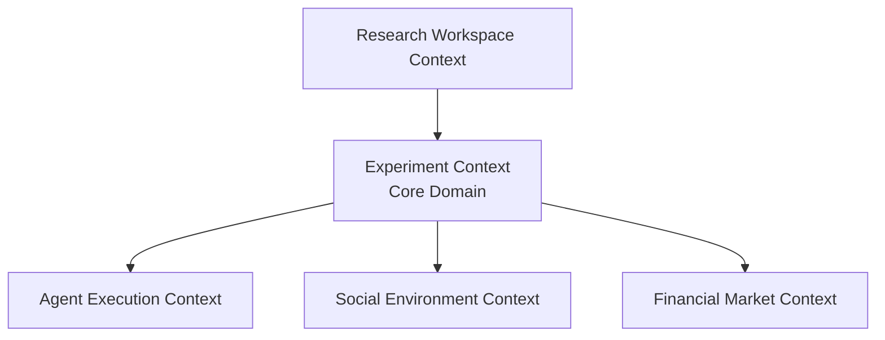

# OpenLeek Context 划分

## 文档目的

本文只记录 OpenLeek 采用 Domain-Driven Design 思想后的战略层 Context 划分。

本文回答：

- OpenLeek 包含哪些 Bounded Context；
- 每个 Context 负责什么；
- 每个 Context 不负责什么；
- Context 之间保持什么关系。

本文暂不讨论：

- 具体领域对象和字段；
- 具体领域模型与机制；
- Context 内部的 package 和代码分层；
- HTTP、gRPC、MCP、Redis 等 transport；
- 数据库选择；
- Context 与 deployable service 的映射；
- 现有架构的迁移方案。

这些内容应当在 Context 边界稳定后分别设计。

## 划分标准

一个 Bounded Context 应当具有相对独立的：

- 业务目的；
- 统一语言；
- 事实所有权；
- 生命周期；
- 不变量；
- 对外协作契约。

Context 不等于页面、package、进程、容器或网络服务。未来可以根据扩容、隔离和运维需求决定部署方式，但部署方式不反向决定 Context 边界。

## Context 总览

OpenLeek 划分为五个 Bounded Context：

1. Research Workspace Context
2. Experiment Context
3. Agent Execution Context
4. Social Environment Context
5. Financial Market Context

其中，Experiment Context 是 OpenLeek 的 Core Domain；其余 Context 为研究实验、Agent 执行和模拟环境提供相对独立的领域能力。

## 1. Research Workspace Context

### 业务目的

支持研究者构思、组织、提交和分析研究工作。

### 负责

- 研究者尚未提交的工作内容；
- 研究项目和研究组织方式；
- 多次实验运行之间的研究关系；
- 研究者定义的比较、分析和注释；
- 面向研究者的长期工作状态。

### 不负责

- 执行实验世界；
- 推进 simulation round；
- 拥有已提交实验的运行状态；
- 拥有 Agent、Social 或 Market 产生的领域事实；
- 修改其他 Context 已经提交的事实历史。

### 边界说明

Console 是 Research Workspace 的一种用户界面，但用户界面本身不定义 Context。Research Workspace 是否成立，取决于它是否拥有独立的研究工作流与事实生命周期。

## 2. Experiment Context

### 业务目的

定义并执行一个受控、可审计、可恢复的 simulation experiment，协调模拟世界从一个一致状态迁移到下一个一致状态。

### 负责

- 实验定义进入执行状态后的权威表示；
- run lifecycle；
- simulation clock 和 round lifecycle；
- 世界状态迁移与提交边界；
- 实验条件、干预和执行顺序；
- 跨 Context 的执行协调；
- 失败、重试、恢复、分叉和回滚语义；
- 实验级 provenance 和完整性判断。

### 不负责

- Agent 内部如何认知和推理；
- Social Environment 的内部规则和事实；
- Financial Market 的内部规则和事实；
- 研究者尚未提交的草稿和研究组织工作。

### 边界说明

Experiment Context 是一次 world transition 的唯一协调者。其他 Context 可以执行自己的领域行为并返回结果，但不能各自推进 Experiment 的 round 或提交全局实验状态。

## 3. Agent Execution Context

### 业务目的

在给定、受限的模拟观察下执行有状态 Agent，并返回候选行为及其执行证据。

### 负责

- Agent 执行身份；
- Agent 的工作空间和持续会话；
- Agent 指令和认知执行环境；
- Agent execution lifecycle；
- Agent 对给定观察的读取；
- Agent 生成但尚未被模拟世界接受的候选行为；
- Agent 执行失败、重试和资源使用证据。

### 不负责

- 决定候选行为是否成为领域事实；
- 直接提交 Social 或 Market 状态；
- 推进 Experiment round；
- 拥有 Social、Market 或 Experiment 的权威事实。

### 边界说明

Agent Execution 的输入是由 Experiment 协调并限定的观察，输出是待处理的候选行为。候选行为只有经过相应 Context 的规则处理并由 Experiment 完成 transition 后，才成为已提交实验事实。

## 4. Social Environment Context

### 业务目的

表示并维护模拟世界中的平台化社会互动、信息分发和社会反馈。

### 负责

- 社会参与者在平台中的身份；
- 社会内容及其关系；
- 社会连接关系；
- 信息的可见性、分发和排序语义；
- 个体实际获得的信息；
- 社会互动与反馈；
- Social Environment 内部的一致性。

### 不负责

- Agent 内部如何解释信息；
- Agent 的持续认知状态；
- 金融账户、订单、成交或 portfolio；
- Experiment 的 round lifecycle 和全局 commit；
- 研究者工作流。

### 边界说明

信息分发结果与对应的实际信息获得事实属于同一个 Context。Social Environment 不应把决定可见内容的语义与记录实际信息获得的事实拆成互不一致的 owner。

## 5. Financial Market Context

### 业务目的

表示并维护模拟世界中的金融机构约束、市场交互、流动性和资产状态变化。

### 负责

- 市场参与者的金融身份与权限；
- 账户、资产和 portfolio；
- 金融行为的受理、约束和拒绝；
- 订单生命周期；
- 市场交互和成交；
- 市场状态与市场结果；
- 流动性机制；
- Financial Market 内部的一致性。

### 不负责

- Agent 如何形成金融意图；
- Social Environment 的内容和信息分发；
- Experiment 的 round lifecycle 和全局 commit；
- 研究者工作流。

### 边界说明

Financial Market 内部可以存在不同制度角色和机制，但是否进一步划分内部模块或物理服务，应在本 Context 的语言、不变量和交互关系明确后决定。

## Context 之间的关系

### Research Workspace 与 Experiment

Research Workspace 负责研究者尚未提交的工作；Experiment 负责已经进入执行边界的实验。提交动作是两者之间的明确边界，提交后的实验表示不能被 Workspace 中后续修改的草稿隐式改变。

### Experiment 与 Agent Execution

Experiment 向 Agent Execution 提供限定的执行上下文；Agent Execution 返回候选行为和执行证据。Experiment 不进入 Agent 内部认知实现，Agent Execution 不直接改变模拟世界。

### Experiment 与 Social Environment

Experiment 决定何时请求或应用 Social 行为；Social Environment 根据自己的领域规则产生 Social 结果。Experiment 协调这些结果进入 world transition，但不接管 Social 内部规则。

### Experiment 与 Financial Market

Experiment 决定何时请求或应用金融行为；Financial Market 根据自己的制度和市场规则产生结果。Experiment 协调这些结果进入 world transition，但不接管 Market 内部规则。

### Social Environment 与 Financial Market

Social Environment 与 Financial Market 不直接读取或修改对方的内部事实。跨领域反馈由 Experiment Context 在明确的 simulation transition 中协调，避免形成隐式依赖和不受控的循环调用。

## 必须保持的架构约束

- 每项权威事实只能有一个 Context owner。
- Context 之间通过显式契约交换信息，不共享对方的内部模型或 repository。
- Experiment 是跨 Context world transition 的唯一协调者。
- Agent 输出在被相应领域规则接受前只是候选行为。
- Research Workspace 不得成为 Experiment、Social、Market 或 Agent 事实的第二权威。
- Context 的模块化不要求每个 Context 独立部署。
- 部署、transport、数据库和 package layout 的决定必须晚于 Context 边界决定。

## 后续讨论顺序

在本文的五个 Context 与关系稳定后，后续设计应按以下顺序继续：

1. 明确每个 Context 的统一语言和核心概念；
2. 明确 Context 之间的 commands、queries、events 和 data contracts；
3. 明确每个 Context 内部的 Application、Domain、Infrastructure 和 Interface 职责；
4. 决定哪些 Context 或模块需要独立部署；
5. 最后制定当前实现向目标架构迁移的计划。
